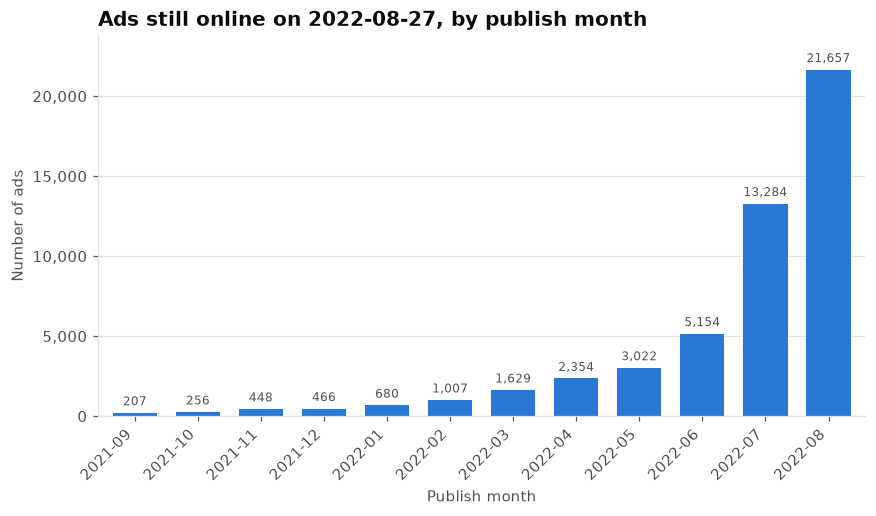
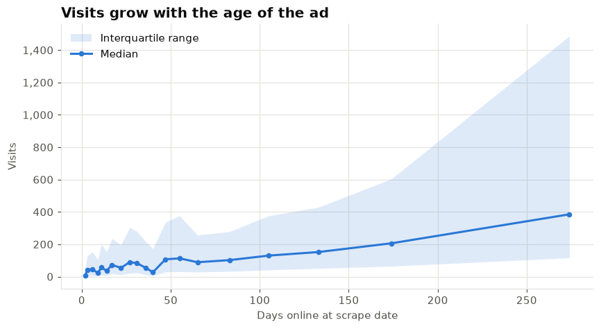
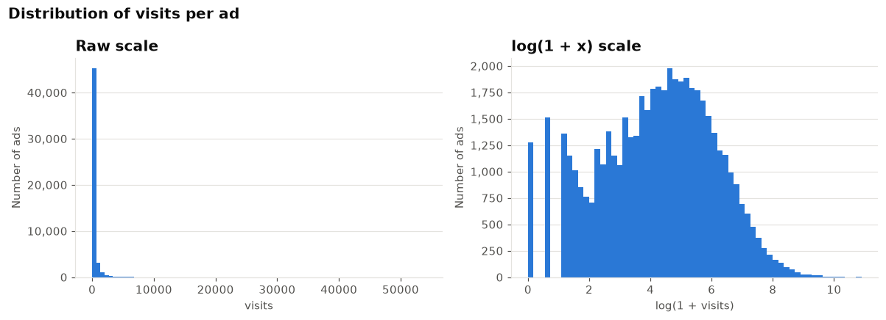
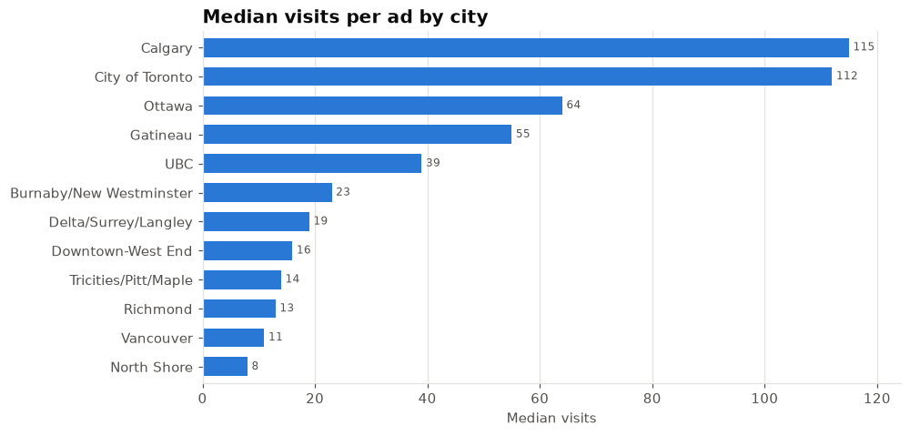
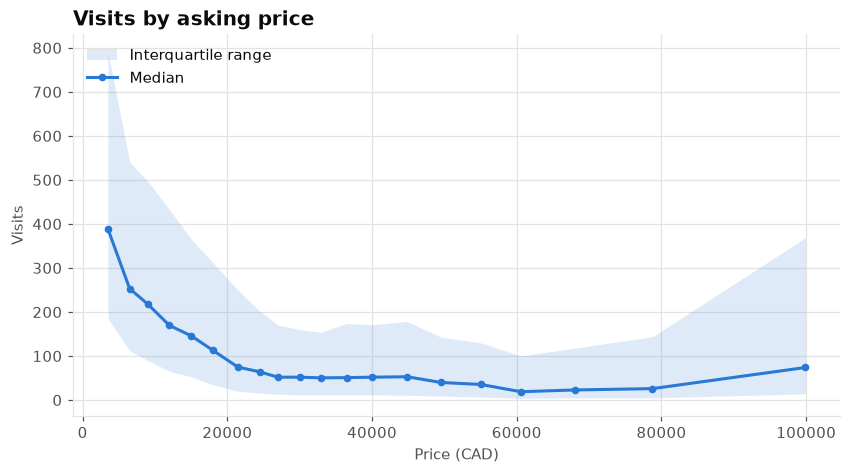
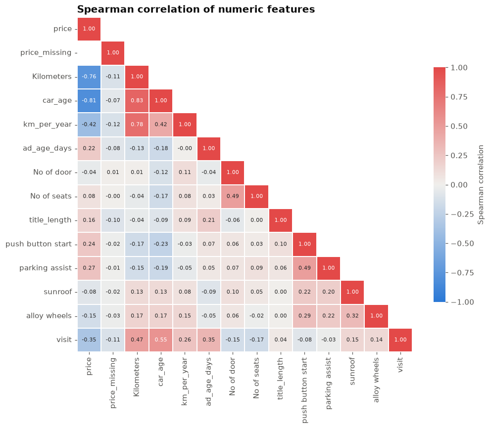
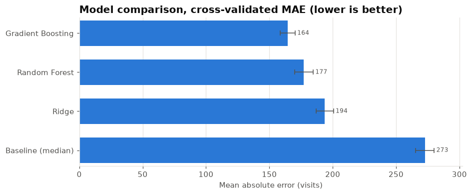
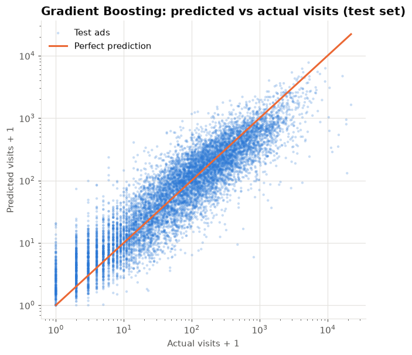
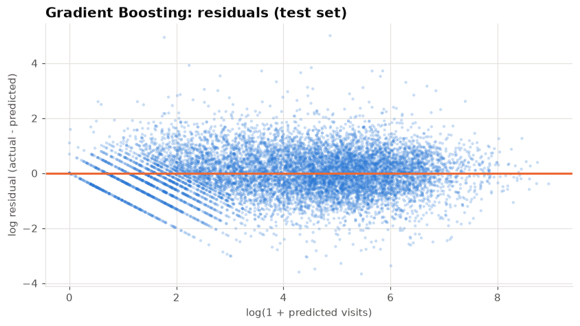
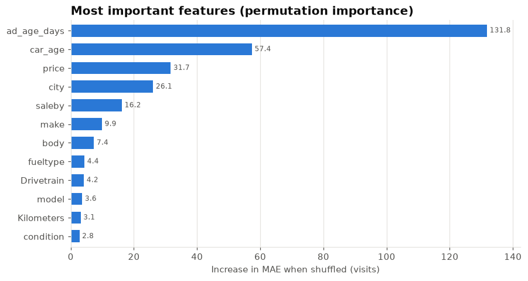

# <font color="#00ced1"><b>Kijiji Car Sales Ads – Predicting Ad Visits</b></font>

Kijiji is one of Canada's largest online classifieds marketplaces, and cars are among its most active categories.
This project analyses about 51,000 car ads scraped from Kijiji and trains a model that predicts **how many visits an ad receives** from its characteristics (price, vehicle, seller, city and how long it has been online).

## Table of contents <a class="anchor" id="0.1"></a>

1. [Business case](#1)
2. [Data identification](#2)
   1. [Metadata](#2.1)
3. [Key findings](#3)
4. [Data preparation](#4)
5. [Modelling](#5)
6. [Results](#6)
7. [How to run](#7)
8. [Project structure](#8)
9. [Limitations and next steps](#9)

>**Group 6**
>- Erwin Mongui (883945)
>- Camilo Florez (888810)
>- Yasar Mansuri (884738)
>- Syed Zumair (885081)

[Back to Table of Contents](#0.1)
## 1. Business case <a class="anchor" id="1"></a>

**Problem definition.** Predict the number of visits a Kijiji car ad will receive from the data available in the listing.

**Why it matters.** Visits are the top of the sales funnel. A visit model can help to:
- tell sellers whether an ad is under-performing compared with similar ads (price too high, missing information…);
- rank or promote listings, and estimate demand by city, make or segment;
- give dealers a benchmark for their inventory.

**Success criterion.** The model must clearly beat a naive baseline (always predicting the median number of visits) on ads it has never seen.

[Back to Table of Contents](#0.1)
## 2. Data identification <a class="anchor" id="2"></a>

The data contains 51,343 rows and 28 columns. Each row is one car ad.

| COLUMN | DESCRIPTION |
|---|---|
| AdID | Unique ad identifier |
| city | Kijiji region where the ad is published (12 regions in BC, AB, ON and QC) |
| latitude, longitude, mapAddress, VIN | Empty in this dataset (100% missing), removed |
| title | Ad heading, usually year + make + model |
| price | Asking price (CAD). Values below $100 are placeholders ("call for price") |
| saleby | `dealer` or `owner` (private seller) |
| make | Vehicle brand |
| model | Vehicle model (~740 distinct values) |
| Trim | Version/package of the model (free text, ~16k distinct values) |
| year | Model year |
| condition | `used`, `new`, `damaged`, `salvage`, `lease_takeover` |
| Kilometers | Odometer reading |
| body | Body type (sedan, suv_crossover, pickup_truck…) |
| Drivetrain | 4x4, awd, fwd, rwd, other |
| fueltype | gas, diesel, hybrid, electric, other |
| color | Exterior colour |
| Date | Date and time the ad was published |
| **visit** | **Target: total number of visits of the ad at scrape time** |
| No of door / No of seats | Number of doors / seats (text, includes "other") |
| Transmission | 0: none, 1: manual, 2: automatic, 3: other |
| push button start, parking assist, sunroof, alloy wheels | 1 when the ad lists the option, empty otherwise |

[Back to Table of Contents](#0.1)
### Metadata <a class="anchor" id="2.1"></a>

- Source: Kaggle, [kijiji-car-sales-ads](https://www.kaggle.com/datasets/hossaingh/kijiji-car-sales-ads?select=AdData.csv) (owner: Hossain)
- Collection: web scraping of the Kijiji website on **August 27, 2022**
- Geospatial coverage: Canada
- License: CC BY-NC-SA 4.0

[Back to Table of Contents](#0.1)
## 3. Key findings <a class="anchor" id="3"></a>

### The data is a snapshot, not a time series
All ads were collected on a single day, so the file only contains ads that were **still online** on 2022-08-27. Ads sell and disappear, so the further back the publish month, the fewer ads remain. This explains why 2022, and August in particular, "dominate".
It is **not** evidence of seasonality, and monthly or yearly totals of visits from this file should not be read as demand trends.



### Visits are cumulative: the longer an ad is online, the more visits it has
The `visit` column counts every visit since the ad was published. The ad age (days between publication and scrape) is therefore the strongest driver of visits and has to be a model feature.



### Visits are extremely skewed
The median ad has 75 visits, the mean is 294, the 99th percentile is about 3,350 and the maximum is 54,064. A handful of very popular ads would dominate any model trained on raw counts, so models are trained on `log(1 + visits)`.



### Who sells and what is sold matters
- **Private sellers get about 3x more visits than dealers** (median 226 vs. 67 for used cars). New cars from dealers get a median of only 8 visits.
- **Older, cheaper, higher-mileage cars attract more visits.** Spearman correlation with visits: car age +0.55, kilometres +0.47, ad age +0.35, price −0.35.
- **Region:** Calgary (median 115) and City of Toronto (112) have far more visits per ad than the BC regions (Vancouver 11, North Shore 8).

| | |
|---|---|
|  |  |



Other EDA charts in `reports/figures`: missing values per column, ads by city, median visits for the 15 most listed makes.

[Back to Table of Contents](#0.1)
## 4. Data preparation <a class="anchor" id="4"></a>

Implemented in `modules/cleansing.py`. The cleaning report from the last run:

| Step | Rows / values affected |
|---|---|
| Exact duplicates and repeated `AdID` removed | 1 row |
| Columns with no data removed (latitude, longitude, mapAddress, VIN) | 4 columns |
| Ads without a `visit` value removed (the target is never imputed) | 802 rows |
| Placeholder prices (< $100 or > $500,000) set to missing + `price_missing` flag | 2,838 values |
| Odometer > 1,000,000 km set to missing | 37 values |
| Model year < 1940 set to missing | 10 values |
| **Clean dataset** | **50,540 ads** |

Other transformations:
- Text categories are normalised (`make` title-cased, "Alfaromeo" → "Alfa Romeo", other categories lower-cased), doors and seats are converted to numbers, and transmission codes are mapped to labels.
- Equipment flags: empty means "not listed in the ad", so it is encoded as 0.
- Derived features: `ad_age_days` (days online at scrape date), `car_age`, `km_per_year`, `title_length`, `publish_weekday`.
- **Outliers in visits are reported, not removed.** `modules/outliers.py` compares six detectors (Z score, robust Z score, IQR, 1–99th percentile, DBSCAN, Isolation Forest). They disagree a lot: they flag between 0.04% and 16% of the ads. The extreme values are real popular ads, so deleting them would bias the model. The log transform of the target handles the skew instead.
- Imputation (median / "missing" category), scaling and one-hot encoding (rare categories pooled, minimum 30 ads) are done **inside the scikit-learn pipeline**. They are learnt from the training folds only, which avoids data leakage.

[Back to Table of Contents](#0.1)
## 5. Modelling <a class="anchor" id="5"></a>

Implemented in `modules/models.py` and `modules/training.py`.

- **Split:** 80% train / 20% test, stratified on visit deciles (`random_state=42`). The test set is used **once**, to report the final score.
- **Model selection:** 5-fold cross-validation on the training set. The model with the lowest cross-validated MAE is chosen.
- **Candidates:** every model is an sklearn `Pipeline` (preprocessing + regressor) wrapped in a `TransformedTargetRegressor` (fit on `log1p(visits)`, predictions mapped back with `expm1`):
  - **Baseline**: always predicts the median. Anything useful must beat it.
  - **Ridge regression**: linear model on log-scaled, standardised features. Simple and interpretable.
  - **Random Forest**: an average of decorrelated decision trees; captures non-linear effects and interactions.
  - **Gradient Boosting** (`HistGradientBoostingRegressor`): trees added sequentially, each one correcting the errors of the previous ones. Usually the strongest choice for tabular data.
- **Metrics:** MAE and median absolute error in visits (easy to explain), RMSE, R² on visits, and R² on the log scale. R² on visits is dominated by the few viral ads; R² on the log scale measures how well the order of magnitude is predicted.

[Back to Table of Contents](#0.1)
## 6. Results <a class="anchor" id="6"></a>

### Cross-validation (training set, 5 folds)

| Model | MAE (± std) | R² | R² (log) |
|---|---|---|---|
| **Gradient Boosting** | **164 ± 6** | **0.40** | **0.82** |
| Random Forest | 177 ± 7 | 0.30 | 0.80 |
| Ridge | 194 ± 7 | 0.24 | 0.75 |
| Baseline (median) | 273 ± 7 | −0.07 | −0.01 |



### Held-out test set (10,108 ads never seen during training or selection)

| Model | MAE | Median AE | RMSE | R² | R² (log) |
|---|---|---|---|---|---|
| **Gradient Boosting** | **158** | **32** | **629** | **0.37** | **0.82** |
| Baseline (median) | 266 | 70 | 819 | −0.07 | −0.01 |

Gradient Boosting reduces the mean absolute error by about **41%** compared with the baseline. For half of the ads the prediction is within about 32 visits. Test scores are in line with cross-validation, so the model is not overfitting.
The model ranks ads well (R² 0.82 on the log scale). It is less accurate for the rare viral ads with thousands of visits, which it tends to under-predict (right side of the chart below).

| | |
|---|---|
|  |  |

### What drives the prediction
Permutation importance (how much the test MAE gets worse when a feature is shuffled): **ad age** is by far the most important feature, followed by **car age**, **price**, **city** and **seller type**. Equipment flags, colour and publish weekday add almost nothing.



The run also writes a table of test error by city to the report, and stores the test predictions in the `PREDICTED` table of `result.sqlite`.

[Back to Table of Contents](#0.1)
## 7. How to run <a class="anchor" id="7"></a>

Requires Python 3.11+.

```bash
python3 -m venv env
. env/bin/activate
pip install -r requirements.txt        # or requirements-dev.txt to also get pytest + ruff
```

```bash
# Full run: EDA + training, reports written to reports/output/, best model saved
python3 main.py --analyze file --training file --save-model

# Quick check on a sample with smaller models
python3 main.py --training console --fast --sample 5000 --no-plots
```

| Option | Description |
|---|---|
| `--analyze {console,c,file,f}` | Run the EDA (tables to console or to `reports/output/<timestamp>_output.txt`, charts to `reports/figures/`) |
| `--training {console,c,file,f}` | Cross-validate the models, evaluate the best one on the test set |
| `--save-model` | Save the best pipeline to `reports/models/visit_model.joblib` with a metadata JSON (features, metrics, sklearn version) |
| `--no-plots` | Skip chart generation |
| `--fast` | Smaller ensembles and 3 CV folds |
| `--sample N` | Use a random sample of N ads |

The full run took about 2 minutes in our test environment (timing varies with the number of CPU cores).

Using the saved model:

```python
import joblib
from modules.cleansing import clean_data
from modules.extraction import read_visits
from modules.features import FEATURES

model = joblib.load("reports/models/visit_model.joblib")
ads, _ = clean_data(read_visits())
ads["visit_predicted"] = model.predict(ads[FEATURES])
```

Tests and lint (also run by GitHub Actions on every push):

```bash
python3 -m pytest
ruff check .
```

[Back to Table of Contents](#0.1)
## 8. Project structure <a class="anchor" id="8"></a>

```
main.py                  CLI entry point
modules/
  config.py              paths, scrape date, split / CV settings
  extraction.py          read the raw CSV
  cleansing.py           cleaning + feature derivation
  features.py            feature lists and preprocessing pipeline
  outliers.py            six outlier detectors (boolean masks) + comparison table
  analyze.py             exploratory analysis (tables + charts)
  models.py              candidate models
  training.py            cross-validation, test evaluation, importance, persistence
  metrics.py             regression metrics
  visualization.py       chart helpers with a consistent, colour-blind-safe style
  output_data.py         console / file report writer
tests/                   pytest suite on synthetic data (no dependency on the real CSV)
data/VISITS.csv          raw dataset
reports/figures/         generated charts
```

[Back to Table of Contents](#0.1)
## 9. Limitations and next steps <a class="anchor" id="9"></a>

- **Survivorship bias.** Only ads still online on the scrape date are observed; ads that sold quickly (often the most attractive ones) are missing. A model trained on several snapshots, or on visits measured at a fixed age (e.g. visits after 7 days), would answer the business question more directly.
- **Ad age dominates.** For a brand-new ad, the useful question is "how many visits will it get in its first N days". With repeated scrapes the target could be defined that way.
- **Missing signals.** Photos, description text and promoted/featured status are not in the data. They probably explain much of the remaining variance, especially for viral ads.
- **Tuning.** Hyper-parameters are sensible defaults. A randomized search on the Gradient Boosting model, and target encoding of high-cardinality columns (`model`, `Trim`), are the next steps.
- **Retraining.** Market conditions change, so the model should be retrained on fresh data periodically and monitored for drift (the saved metadata records the training date and metrics).


